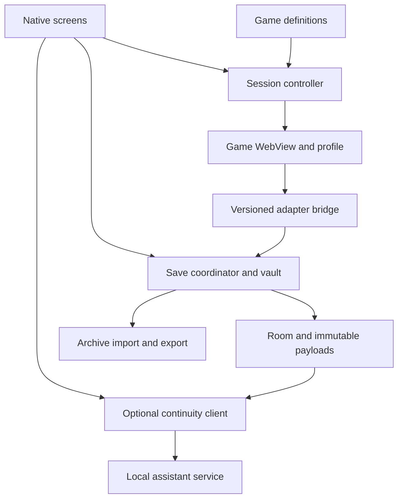

# Incremental Hub: technical specification

Version: 1.0  
Date: 2 October 2026  
Status: design baseline for implementation planning  
Primary user and target device: Matty, Google Pixel Fold  
Working product name: Incremental Hub

## 1. Purpose and implementation mandate

Build a local-first Android home for a curated collection of browser incremental games. It must offer comfortable fullscreen play, preserve progress independently of browser storage, and help the user resume a complex game after weeks or months away.

This document defines architecture, component responsibilities, contracts, safety properties and milestone acceptance criteria. Cursor or Claude should derive implementation plans and code from it. It is not evidence that any game integration has already passed testing.

**First useful release:** multiple isolated games, a fold-aware play surface, versioned save snapshots, protected checkpoints, recoverable restore, and portable vault export/import. A later, explicitly invoked local-LLM assistant explains prior objectives and suggests terse, evidence-backed next steps.

The initial candidate games are FE000000, Shark Incremental and BIOTOMATA. Their compatibility must be established individually. A game that renders successfully is not automatically safe to back up or restore.

Normative language: **MUST** is an acceptance requirement; **SHOULD** is the default unless an architectural decision record explains a deviation; **MAY** is optional. Requirements introduced in later milestones are not dependencies for v0.1 unless explicitly stated.

### 1.1 Product principles

- Resume is the primary action. Playing should require one tap from the launcher.
- Save protection must be observable and honest about its coverage and freshness.
- Core play, snapshots, restore, notes and export work without an account or LLM.
- Native state and immutable vault records are authoritative for Hub metadata. The game remains authoritative for its own progress and offline calculations.
- Add support through declarative game definitions and small, versioned adapters.
- Preserve user agency: no autonomous gameplay, prestige, purchase, respec or import by the assistant.
- Optimise for a handful of excellent games. Universal website support is outside the product boundary.
- Bare-bones native UI is sufficient initially. Correctness takes priority over decoration.

### 1.2 Explicit exclusions from v0.1

Universal IndexedDB backup, arbitrary URL support, browser login management, account sync, continuous background simulation, game discovery, social features, community executable packs, automatic game updates, game-version pinning, advanced pointer emulation and LLM assistance.

The first release MUST include manual external export and archive import. Automatic external backup is later. A vault confined to app storage cannot protect against uninstall, clearing app data or losing the phone.

## 2. Platform facts and design boundaries

These distinctions supersede optimistic shortcuts in the exploratory discussion.

| Topic | Required interpretation |
|---|---|
| WebView profiles | Named profiles are available through AndroidX WebKit, subject to runtime feature support. Never silently fall back to a shared profile. [R1–R3] |
| Save capture | Reading localStorage captures persisted strings, not necessarily the latest JavaScript heap state. Freshness depends on a proven game save/export hook. |
| WebView state | Keeping a WebView alive can preserve an active session through supported configuration changes. Process death destroys the JavaScript heap; `saveState()` is not a game checkpoint. [R4, R5] |
| Generic backup | The platform `WebStorage` API is not a complete export/import interface for arbitrary browser state. [R6] |
| Restore | Storage writes and arbitrary page execution do not form one atomic transaction. Use a durable operation journal and a separate candidate profile. |
| Backgrounding | A final lifecycle callback or asynchronous JavaScript response may never arrive. Foreground snapshots provide the baseline; exit snapshots are additional protection. |
| Navigation | Restricting page navigation does not create an outbound network firewall. Scripts, frames and workers have separate network behaviour. |
| Embedded games | An itch.io landing page and its game iframe can have different origins and storage contexts. BIOTOMATA visibly uses an iframe; qualify the actual game context. [R11] |
| External backup | SAF support varies by document provider. Do not promise writable Google Drive folders, atomic renames, or confirmed cloud upload merely because a provider is visible. [R7, R8] |
| Remote updates | An upstream site may change between requests. Version detection is advisory until a complete local package can be pinned. |
| Orientation | Treat orientation preferences as requests. Large-screen Android behaviour can override restrictions; layout must adapt anyway. [R10] |

### 2.1 Technology decisions

| Area | Decision |
|---|---|
| Android application | Kotlin, one application, Jetpack Compose and Material 3 |
| Game renderer | Android System WebView through an explicitly owned `AndroidView` host |
| Platform floor | `minSdk 30` as a project choice; compile/target the stable SDK selected at implementation kickoff |
| Web integration | Stable AndroidX WebKit; pin exact dependency versions in the version catalogue |
| Metadata | Room with explicit migrations, no destructive migration fallback |
| Preferences | DataStore for global/per-game display preferences; transactional session/profile pointers remain in Room |
| Payloads | Immutable compressed files in app-private durable storage, never cache directories |
| Asynchronous work | Kotlin coroutines; WebView calls on the main thread; filesystem/hash/database work off it |
| External file access | Storage Access Framework, persisted grants where supported |
| Deferred work | WorkManager for exporting existing native snapshots, never for executing games |
| Serialisation | Versioned JSON with Kotlin serialisation; opaque game strings preserved losslessly |
| Dependency injection | Constructor injection and a small composition root initially |
| Optional assistant service | Later: Python FastAPI, SQLite FTS5 guide index, HTTP client to a configured local inference server |

M0 MUST record selected SDK, Kotlin, Compose, WebKit, Room and Gradle versions and test the chosen WebView provider. Do not infer runtime capability from Android OS version alone. Require `MULTI_PROFILE`, `DOCUMENT_START_SCRIPT` and `WEB_MESSAGE_LISTENER` for the supported integration path. If unavailable, show remediation and keep vault browsing/export accessible.

## 3. Architecture and ownership

Use a modular monolith. Start with cohesive packages in one Android module; split Gradle modules only when build or testing needs justify it. Avoid a plugin framework or service mesh inside the phone.



### 3.1 Components

| Component | Owns | Does not own |
|---|---|---|
| `GameRegistry` | Validated definitions, adapter associations, compatibility records | Live WebViews or saves |
| `SessionController` | Session lifecycle, active instance, WebView creation/destruction, profile binding, navigation | Archive parsing or game mechanics |
| `BridgeHost` | Origin/frame validation, message correlation, payload limits, adapter requests | Filesystem or arbitrary native commands exposed to pages |
| `AdapterRuntime` | Bounded game-specific capture, validation, import preparation, metadata extraction | Retention, external destinations or model inference |
| `SaveCoordinator` | Serialised capture/restore operations and their journals | UI-owned coroutines or renderer lifetime |
| `VaultRepository` | Immutable payloads, snapshot records, integrity checks, retention | WebView storage internals |
| `ArchiveService` | Portable export/import, checksum verification, staging and merge | Direct writes into a running game |
| `ContinuityRepository` | Notes, capsules, screenshots, session summaries | Inventing progress data |
| `Diagnostics` | Bounded local events, capability reports, sanitised support export | Remote analytics |
| `ContinuityClient` | Explicit requests, minimal context packaging, result validation | Unrestricted WebView access |

Suggested package boundaries: `ui`, `games`, `session`, `bridge`, `adapters`, `vault`, `archive`, `continuity`, `diagnostics`, `assistant`. Keep pure validation, retention and archive rules independent of Android classes so they can be tested without a device.

### 3.2 Data ownership layers

1. **Live game state:** JavaScript heap and the selected WebView profile. Useful for play; not the sole durable record.
2. **Native vault:** immutable snapshots with provenance and validation. Independent of WebView storage, but in the same app/device failure domain.
3. **External archive:** a validated portable copy outside the app. A folder on the same phone protects against app removal, not phone loss. Off-device replication is a separate property.

Never copy Chromium's private profile directory as the canonical backup format. Never use cache clearing, WebView data deletion or app data reset as routine troubleshooting.

## 4. User interaction contract

### 4.1 Launcher

Show recently played games first. Each card shows name, Resume, last played, latest successful snapshot time, protection status and, once available, a short resume note. Secondary actions: vault, display settings and diagnostics.

Use explicit protection labels such as `Captured 4 minutes ago`, `Restore tested`, `Capture failed` and `External copy 2 days ago`. Do not collapse capture validity, restorability and external replication into one green tick.

Unsupported games can appear as candidates with an explanation, but MUST NOT display a protected status. v0.1 adds games through shipped definitions, not arbitrary URLs.

### 4.2 Play surface

The game occupies available space with correct cutout, hinge and keyboard handling. Provide a small movable, accessible menu handle. Android Back opens the native game menu when no modal is open; it must not silently navigate back to a reset/start page or close the session. Back closes the menu first when already open.

The menu contains Resume, Snapshot now, Checkpoint, Vault, Reload, Display, and Return to hub. Add Notes and Assistant only when implemented. Compact windows use a bottom sheet; wider windows may use a side panel. Opening a menu MUST NOT recreate or reload the WebView.

No edge swipe is the only way to access controls: it can conflict with Android navigation and game input. Native controls need accessible labels and at least 48 dp touch targets. No pull-to-refresh.

Use accurate labels: `Snapshot now` copies state into the Hub vault. Show `Game save freshness unknown` when the adapter cannot force or observe game persistence. A checkpoint pins a successful snapshot and optionally adds a title; it is not a separate save format.

### 4.3 Vault and destructive actions

Timeline entries show capture time, reason, validation state, size, protection pins and available game metadata. Snapshot detail offers Restore, Export, Protect/unprotect and Delete. Restore confirmation identifies source time and the current state that will be preserved.

Reload first requests a snapshot. If capture fails, show the failure and require an explicit `Reload anyway` action. Return to hub may proceed after a bounded best-effort capture, displaying its result. Android shutdown must not be blocked indefinitely.

Game removal defaults to archiving the launcher entry and retaining its vault. Deleting live profile data, deleting snapshots, and deleting the entire game's history are distinct actions. Bulk deletion shows the affected scope and whether an external copy exists.

### 4.4 Display preferences

v0.1: fullscreen toggle, text zoom, pinch zoom preference, follow-device orientation and keep-awake while foregrounded. Later: separate compact/expanded presets, viewport mode, user-agent mode, tested CSS fixes and shortcut controls.

Use current window size for layout decisions, not a hard-coded device model or fold boolean. Hinge/posture information supplements window size. Applying a setting that needs reload must say so and follow the snapshot-before-reload flow.

## 5. Game identity, definitions and compatibility

Distinguish `gameId` (catalogue identity), `instanceId` (one user's playthrough) and `profileGenerationId` (one WebView storage generation). v0.1 exposes one instance per game; the model allows future alternate runs without confusing their saves.

Each definition is versioned JSON validated at build time and load time. Fields:

| Field | Meaning |
|---|---|
| `schemaVersion`, `definitionVersion` | Format and game-definition revisions |
| `gameId`, `displayName`, `sourceUrl` | Stable identity and provenance |
| `launchUrl` | Exact approved initial location |
| `navigationRules` | Parsed HTTPS origins and path boundaries for top-level navigation |
| `storageContext` | Authoritative origin and frame mode; v0.1 default is top-level |
| `adapterId`, `adapterVersion` | Bundled executable adapter and compatible payload formats |
| `saveCoverage` | Authoritative keys/stores/exports covered, excluded data and freshness capability |
| `displayDefaults` | Conservative responsive defaults |
| `versionProbe` | Optional bounded probe and evidence type |
| `compatibility` | Status, tested provider, game fingerprint, evidence date and report reference |
| `resourceObservations` | Observed dependencies, not a promise of network isolation |

Illustrative shape, deliberately not a qualified game integration:

```json
{
  "schemaVersion": 1,
  "definitionVersion": 1,
  "gameId": "example-incremental",
  "displayName": "Example Incremental",
  "sourceUrl": "https://example.org/game/",
  "launchUrl": "https://example.org/game/",
  "navigationRules": [{"origin": "https://example.org", "pathPrefix": "/game/"}],
  "storageContext": {"origin": "https://example.org", "frameMode": "top-level"},
  "adapterId": "local-storage-v1",
  "adapterVersion": 1,
  "saveCoverage": {"keys": ["example-save"], "freshness": "persisted-only"},
  "displayDefaults": {"orientation": "auto", "textZoomPercent": 100},
  "compatibility": {"status": "candidate"}
}
```

Normalise scheme, host and effective port with a URL parser. Match path segment boundaries, not arbitrary string prefixes. Reject credentials in URLs, malformed escapes, lookalike hosts and unexpected scheme changes. Changes to game identity, authoritative origin or storage context require an explicit migration, never a silent definition update.

### 5.1 Initial compatibility work

| Candidate | Entry/source | Required proof |
|---|---|---|
| FE000000 | `https://dan-simon.github.io/misc/fe000000/` | Inspect actual keys, serialisation, save cadence, readiness and import path; prove round-trip |
| Shark Incremental | `https://mrredshark77.github.io/shark-incremental/` and upstream repository [R12] | Same checks; do not assume other games on the same GitHub Pages origin are isolated by path |
| BIOTOMATA | Author's itch.io page [R11] | Identify actual runtime URL/origin, frame/storage behaviour and save mechanism; verify fold resizing |

Prefer an author-supported direct runtime URL when stable and permissible. Do not scrape a transient iframe URL and declare permanent support. If BIOTOMATA requires cross-origin frame coordination or a different storage backend, defer that integration to M6 with an explicit blocked report. Do not weaken bridge permissions or pretend top-level itch.io storage is the save.

Compatibility levels: `candidate`, `play-tested`, `capture-tested`, `restore-tested`, `degraded`, `unsupported`. Only `restore-tested` qualifies as fully supported for v0.1. The report must include a progressed fixture, exported fixture, fresh-profile restore result, process-restart result, provider version and known exclusions. Keep fixture contents out of ordinary logs.

Storage probes report `observed`, `not observed during this session`, or `uninspectable`. An empty IndexedDB listing does not prove a game never uses IndexedDB. No detection heuristic may promote a game to fully supported automatically.

## 6. Session lifecycle and profile isolation

### 6.1 Profile rules

Allocate profile names from opaque instance and generation IDs. Bind a newly constructed WebView to its profile before configuring scripts, calling JavaScript or navigating. The AndroidX API requires this early ordering. [R1]

Use profile-scoped cookie/service-worker facilities where supported. Do not accidentally inspect or clear the default profile when operating on a game. Two games at the same origin MUST remain isolated because their profiles differ. [R2]

v0.1 has one active game WebView. Switching games captures the old session, closes/destroys its WebView and opens the next instance. Persisted state survives switching; the old JavaScript heap does not. Returning briefly to the native hub may retain the active WebView until memory pressure or explicit session closure.

All operations for an instance are serialised. Capture, restore, profile deletion, definition migration and archive activation cannot race. External export reads immutable committed records and can run independently.

### 6.2 Lifecycle states

`CLOSED → OPENING → PLAYING → CAPTURING → PLAYING` is the normal path. Also support `BACKGROUND`, `RESTORING`, `DEGRADED`, `RECOVERY_REQUIRED` and `CLOSING`. Transition handling belongs in `SessionController`, not scattered Compose callbacks.

Handle relevant configuration changes to avoid unnecessary Activity recreation, as verified on the Fold. Keep the WebView outside transient composable branches; recomposition must reuse its identity. Do not keep an Activity-bound WebView in a long-lived ViewModel. Unexpected recreation and process death must still recover through durable state. [R4]

Foreground capture cadence is 60 seconds by default. This cadence is separate from retention buckets. Use a lifecycle-bound coroutine, not WorkManager. Before normal suspension request a best-effort capture, then pause foreground work. Never claim JavaScript will run continuously while backgrounded.

A renderer crash must detach and destroy the failed WebView, invalidate pending bridge requests and show recovery. Do not immediately reload in a loop. Keep native vault access available. [R5]

### 6.3 Cold start and protection against empty state

Before launching game code, inspect the authoritative saved keys using a native-supplied bootstrap document at the qualified storage origin. The bootstrap contains no game scripts or network dependencies. Loading a native HTML document with an HTTPS base origin is an available mechanism; origin and storage behaviour MUST be proven in M0. [R9]

The bootstrap must capture any existing persisted data and compare it with the last structurally valid snapshot before the remote game can migrate or overwrite it. A populated existing profile gets a protected pre-launch snapshot. Empty or unparseable storage with previous history enters recovery UI; it must not automatically initialise a new run and promote that as healthy.

Use a temporary launch-operation pin for that snapshot. Release it only after the game loads and a subsequent capture passes the adapter's validation without an unresolved anomaly; normal retention then applies. Failed or incompatible launches keep the pin until resolved. A genuinely new instance with no history may initialise normally. Authorise the bootstrap's exact native-served URL/context separately from remote game navigation; never allow upstream navigation into that reserved route.

Service workers may affect the bootstrap path. Qualification must prove the chosen mechanism reaches native-supplied content without executing upstream code, including after a service worker has been installed. If this cannot be guaranteed for a game, mark the pre-launch guard unavailable and block full support until an adapter-specific solution exists.

Never restore the latest snapshot on every launch. Normal resume uses existing live storage. Automatic replacement could discard newer progress or replay offline rewards. Recovery/restore is a distinct operation with an explicit source.

## 7. Adapter and bridge contracts

### 7.1 Adapter capabilities

The following is a language-neutral contract, not an instruction to invent these functions in upstream games:

```text
probe(context) -> capability report
awaitReady(deadline) -> ready | unsupported | timeout
capture(reason) -> payload + coverage + freshness + warnings
validate(payload, versionContext) -> validation result
prepareRestore(payload) -> storage mutations or qualified import recipe
verifyLoaded(expectedSummary) -> restored | mismatch | inconclusive
extractMetadata(payload) -> optional spoiler-labelled semantic state
readScreen() -> optional bounded, sanitised visible-state summary
```

Separate pure native validation from JavaScript execution. The adapter declares whether it can force the game to persist, export current in-memory state, or only read last-persisted state. Do not invent `exportSave()` or `importSave()` merely because the game has buttons with those labels; inspect actual source and behaviour.

Preferred order: documented/native save serialisation when accessible and tested, otherwise qualified localStorage capture, then a bespoke adapter. An import recipe that needs game code must run only in a candidate profile and remain invisible to the active instance until verification.

### 7.2 Generic localStorage v1

Represent storage as an array of exact string key/value pairs. Preserve all UTF-16 code units, including unusual strings, through reversible JSON escaping. Do not decode and re-encode an opaque save unless the game adapter explicitly owns that transformation. Reject duplicate keys on import.

Capture the configured authoritative keys in one synchronous JavaScript task. Single-page localStorage access in that task avoids interleaving with that page's own tasks; it does not prove atomicity across multiple frames or unrelated contexts. v0.1 therefore qualifies single-authoritative-context games only.

If an adapter can safely invoke the game's save routine, do so and wait for its proven completion signal before reading. If it cannot, record `persisted-only` and `gameSavedAt=null` unless the save itself supplies a trustworthy timestamp. Captured-at time must never masquerade as game-saved-at time.

An adapter must establish that its chosen keys cover authoritative progress. Backing up all localStorage in a dedicated game profile is allowed after inspection, but label excluded mechanisms. Cookies, sessionStorage, IndexedDB, OPFS, CacheStorage and JavaScript heap are not included by this adapter. Do not treat a copied browser preference as proof of protected progress.

### 7.3 Bridge protocol

Use an origin-restricted `WebMessageListener` and a short document-start bootstrap. Install listeners/scripts before navigation. Register exact approved origins; never `*`. Origin matching does not provide path matching. [R1]

Every message includes:

```json
{
  "protocolVersion": 1,
  "sessionId": "opaque-session-id",
  "navigationEpoch": 7,
  "requestId": "opaque-request-id",
  "type": "capture-result",
  "adapterVersion": 1,
  "payload": {}
}
```

Native code verifies the platform-supplied source origin, expected frame mode, active WebView, instance, navigation epoch, outstanding request, size limit and schema. Ignore late or unsolicited messages. A new navigation invalidates old requests. Page-supplied IDs are correlation values, not proof that a page is trustworthy.

v0.1 accepts messages only from the main frame. Later frame-aware adapters require explicit qualification and origin binding. Never grant the page native filesystem paths, arbitrary HTTP access, shell commands, model credentials, snapshot deletion or restore initiation. Page requests cannot initiate export or assistant calls.

Use fixed trusted scripts and serialised data arguments; never concatenate raw saves or notes as JavaScript source. The game may be malicious or compromised, so native validation remains necessary even for expected origins. Broad `addJavascriptInterface` exposure is forbidden.

Initial limits: 8 MiB uncompressed capture payload, 256 KiB transport chunks, 10-second foreground capture deadline, 2-second best-effort background request budget. Assemble at most one capture per instance. Reject duplicate/out-of-order chunks and incomplete replies. Limits are product defaults, not claims about Android maximums; raise only with fixtures and memory measurements.

## 8. Vault data model and durability

### 8.1 Entities

| Entity | Essential fields |
|---|---|
| `GameDefinitionRecord` | game ID, definition version, source hash, compatibility report |
| `GameInstance` | instance ID, game ID, active profile generation, archived flag |
| `ProfileGeneration` | generation ID, profile name, role, created time, retirement state |
| `Snapshot` | immutable ID, instance, parent ID, capture sequence, payload hash, envelope, validation |
| `SnapshotPin` | snapshot ID, reason, operation/capsule/user reference |
| `OperationJournal` | operation ID/type, source/candidate generations, stage, checkpoint IDs, last error |
| `Session` | instance, start/end times, foreground duration, closure reason |
| `Note` / `ResumeCapsule` | user-authored or accepted text, evidence snapshot, optional screenshot/route |
| `ExternalCopy` | archive ID, manifest hash, destination URI, completion/verification times, scope |

Use UTC ISO-8601 timestamps for portability and device-local display. Also store a monotonically increasing per-instance capture sequence so clock changes do not reorder history. Foreground durations use a monotonic clock. Branch ancestry records intentional restores; lower progression after a restore is not automatically corruption.

### 8.2 Snapshot envelope

```json
{
  "formatVersion": 1,
  "snapshotId": "uuid",
  "instanceId": "uuid",
  "gameId": "example-incremental",
  "parentSnapshotId": null,
  "captureSequence": 42,
  "capturedAt": "2026-10-02T16:00:00Z",
  "gameSavedAt": null,
  "reason": "periodic",
  "origin": "https://example.org",
  "definitionVersion": 1,
  "adapter": {"id": "local-storage-v1", "version": 1},
  "gameVersion": {"value": null, "evidence": "unknown"},
  "coverage": {"backend": "localStorage", "keys": ["example-save"]},
  "freshness": "persisted-only",
  "payload": {
    "encoding": "json-utf8-gzip",
    "sha256": "hash-of-exact-uncompressed-payload-bytes",
    "uncompressedBytes": 1234
  },
  "validation": {"integrity": "passed", "structure": "passed", "restore": "not-tested"},
  "metadata": null
}
```

The actual hash must be computed, never populated from the example. Store the original payload bytes used for hashing; compression changes must not change identity. Semantic metadata is derived and discardable. Preserve very large numbers as decimal strings or the game's explicitly tagged number representation, never ordinary floating-point values in the portability layer.

### 8.3 Atomic publication

1. Capture into bounded native memory or a temporary stream; validate without changing the live game.
2. Write the payload to a temporary file in the vault filesystem, flush and sync it, then atomically rename to its immutable hash-based path. Sync the parent directory where supported.
3. In one Room transaction, publish the snapshot record, validation result, operation event and any pins. A snapshot becomes visible only after its payload is durable.
4. On startup, reconcile incomplete journals and orphan files. Never silently discard a metadata row whose blob is missing: mark it corrupt and offer other snapshots.

Deduplicate identical payload blobs. Snapshot events can reference a shared blob while preserving distinct timestamps/reasons. Garbage collection deletes a blob only when no snapshot, pin, operation or export holds it. Use a committed deletion/tombstone process and reconcile interruption.

Use OS app isolation for local privacy. v0.1 archives are unencrypted and labelled accordingly. Later encryption must use a portable passphrase-based authenticated format; a device-only Keystore key cannot be the only way to decrypt a migration archive.

## 9. Capture policy, validation and retention

### 9.1 Triggers and freshness

Capture every 60 seconds while actively playing, on manual request, on checkpoint, before app-controlled reload/import/restore/switch, on normal exit, and best-effort on background. Snapshot the existing persisted state before cold launch as described above.

Coalesce simultaneous requests and honour stronger reasons/pins. Retain useful previous snapshots if a new attempt fails. A timer firing is not success; only durable publication updates the latest-capture indicator.

Healthy foreground target: at most roughly 60 seconds since the last capture attempt, plus capture latency and any game persistence lag. This is not a hard recovery-point guarantee under process death or a malfunctioning adapter. Diagnostics must show measured age and consecutive failures.

### 9.2 Validation levels

Keep separate fields rather than one universal `verified` boolean:

1. **Integrity:** stored bytes exist and match checksum.
2. **Structure:** adapter recognises the payload and required fields/keys.
3. **Plausibility:** comparisons identify suspicious resets or incompatible versions.
4. **Restore evidence:** fixture-tested adapter compatibility, or an actual restore verification for this snapshot.

Checksums prove byte integrity, not that a save is playable. A successful load with a non-empty screen does not prove correct progress. Game-specific verification compares stable progress markers and expected structure, accounting for legitimate offline gains and migrations.

Initial anomaly signals: disappearance of authoritative keys, parse failure, save-format change, or an uncompressed size drop greater than 80% against the latest accepted snapshot when the old payload exceeded 4 KiB. Size is a heuristic only. Prestiges, compression changes and deliberate new runs can be legitimate.

When suspicious, retain the candidate as quarantined, pin the last accepted baseline, stop promoting snapshots into the healthy history and suspend pruning for that instance. Show an actionable warning. Never equate rising currency with validity or falling currency with corruption. User resolution records whether this was an intentional branch, an accepted change or a restoration.

### 9.3 Retention

Default policy per instance is the union of these sets:

| Set | Retention rule |
|---|---|
| Recent | Last 10 successful captures |
| Ten-minute | Latest eligible snapshot in each of the last 12 non-empty UTC ten-minute buckets |
| Hourly | Latest eligible snapshot in each of the last 24 non-empty UTC hourly buckets |
| Daily | Latest eligible snapshot in each of the last 30 non-empty UTC daily buckets |
| Weekly | Latest eligible snapshot in each of the last 12 non-empty ISO UTC weeks |
| Protected | All snapshots with active user, capsule, recovery or operation pins |
| Baseline | Most recent accepted snapshot regardless of age |

Non-empty buckets count actual history, so six months without play cannot age every save out of the vault. Use sequence as the tie-breaker for equal or regressed device timestamps. Never prune while an anomaly or restore operation is unresolved. Avoid unlimited quarantined growth by pausing automatic capture at the storage cap while preserving all existing evidence.

Default soft budget: 250 MiB for the vault, excluding separately pinned future game packages. At the limit, prune eligible unpinned records; if insufficient, stop adding automatic payloads and report degraded protection. Never delete a protected checkpoint to satisfy a quota. Reserve space/check capacity before restore and export. No hard guarantee depends on saves being tiny.

## 10. Restore and recovery protocol

### 10.1 Restore through a candidate profile

Use a separate profile generation for each restore attempt. The source profile remains authoritative until successful commit. This provides recoverability without pretending that WebView storage supports a cross-system transaction.

| Stage | Action and durable evidence |
|---|---|
| `PREPARED` | Validate source snapshot, adapter/version compatibility and space; journal source generation and target snapshot |
| `SOURCE_PRESERVED` | Capture and pin the current state if possible; close its WebView; retain its profile |
| `CANDIDATE_CREATED` | Allocate an empty generation and bind a fresh WebView; record its identity |
| `STORAGE_WRITTEN` | Load trusted origin bootstrap; write the exact approved keys; read back and compare before upstream scripts run |
| `GAME_VALIDATED` | Remove restore-only hooks, load the game, await readiness and perform adapter verification |
| `COMMITTED` | Atomically change the active profile pointer and operation state in Room; record a post-restore snapshot |
| `ROLLED_BACK` | Leave/revert authority to the source generation; retain candidate diagnostics |

If current capture fails, normal restore stops before mutation. Recovery from already broken/empty live storage may proceed only after the user explicitly chooses recovery and the original profile is retained untouched. The source profile itself remains a fallback even when its contents cannot be captured.

The restore bootstrap runs without upstream JavaScript; asynchronous arrival of data must never race the game's initial load. Do not clear storage on a running game and hope a reload wins. Do not install a permanent document-start restore script that repeatedly overwrites later saves.

The authoritative storage payload excludes caches and authentication unless an adapter explicitly qualifies them. Games depending on server-side state or unbacked browser stores cannot use generic candidate-profile restore. Multiple-origin restore requires a later qualified adapter.

If structural readback succeeds but game verification is inconclusive, do not silently commit. Show the candidate preview and ask the user whether to accept it, retaining the source and marking verification as user-confirmed. Fully supported games should normally have deterministic verification.

### 10.2 Interruption handling

On process restart, inspect the journal before loading game code. Before `COMMITTED`, the source remains active; resume validation or discard the candidate. After commit, the recorded candidate is active even if UI acknowledgement was lost. Operations are idempotent and a stale bridge result cannot advance a different attempt.

If the post-restore snapshot fails after authority has committed, keep the committed candidate active and report degraded capture protection. Retry that capture independently. Do not retroactively label the operation uncommitted or silently change the active generation; undo remains an explicit recovery operation.

Retain the previous source profile until at least seven days have elapsed, two subsequent successful captures exist and no operation references it. Its pinned pre-restore snapshot remains for at least 30 days and through one successful external export; user-protected pins remain indefinitely. Respect platform profile deletion constraints and defer cleanup to a safe startup if necessary. [R3]

Never delete the active profile. Maintain a visible Undo restore path while the source is retained. Repeated failed attempts must clean eligible candidate profiles rather than leaking generations indefinitely; cap unresolved candidate generations at three per instance and require resolution before another attempt.

## 11. Portable vault format and external backup

### 11.1 Archive format v1

Extension: `.ihub`. Container: ZIP with `manifest.json`, game/instance records, snapshot envelopes and immutable payload blobs. Later sections hold notes, capsules, screenshots and user display settings. Include definition metadata and adapter identifiers/hashes, but never auto-execute scripts from an archive.

The manifest specifies format version, archive ID, creation time, exporting app version, every member path/length/hash and included instance/snapshot IDs. It also records exclusions. Preserve snapshot IDs and ancestry. A hash detects accidental corruption; it is not a digital signature or proof of trusted authorship.

Adapters remain bundled/trusted application code in v0.1. Imported definitions are inert until matched to an installed adapter and validated navigation/storage policy. Unknown games may be preserved and browsed without being launchable. Do not import credentials, endpoint tokens, raw WebView profiles, authentication cookies or ephemeral SAF grants.

### 11.2 Export

Take a consistent logical snapshot of committed records and pin referenced blobs for the export duration. Build the archive in app-private temporary storage, verify its complete manifest and contents, then write it through the chosen document URI. Release export pins on completion or reconciled cancellation.

Use unique destination filenames. Do not overwrite the only external backup. Mark the copy `written` only after successful close; mark `verified` only after readback validation when supported. Provider completion does not prove remote cloud replication. A cloud-synced folder can report `provider accepted; remote replication unknown`.

v0.1 provides Export everything and Export selected game via `ACTION_CREATE_DOCUMENT`, plus archive import via `ACTION_OPEN_DOCUMENT`. These user-selected operations use SAF. [R7]

Later automatic backup accepts a persisted directory grant only where the provider supports it. Otherwise retain manual exports or use a tested provider-specific integration. A local folder replicated by the user's existing tooling is a valid deployment choice, not a built-in sync guarantee.

### 11.3 Import

Treat all archive input as untrusted. Reject path traversal, absolute paths, duplicate member names, symlinks, duplicate IDs with different content, unsupported major formats and hash mismatches. Enforce streamed limits before allocation: 512 MiB compressed input, 1 GiB total expanded size, 10,000 entries and the 8 MiB save-payload limit. These limits are configurable only through an explicit validated change.

Validate the entire archive in staging before committing metadata. Failed import leaves the existing vault unchanged. Existing identical IDs deduplicate. Divergent instances remain separate or require an explicit conflict choice; never implement last-writer-wins based only on device timestamps.

Import adds historical records; it does not overwrite live game storage. Activating an imported save invokes the normal restore protocol. On a new device, create a fresh local profile generation and restore a selected snapshot. URI permissions and device-specific credentials must be reconfigured.

Support future minor metadata extensions by preserving unknown fields or retaining the original envelope. Reject unsupported payload/major format versions without deleting their bytes. Schema migrations must operate on copies and retain a recoverable original.

### 11.4 Background backup and Android backup

Later schedule daily best-effort WorkManager exports of committed native data, with retry/backoff and destination-grant health. A separate foreground capture timer supplies game snapshots. Periodic WorkManager work has a minimum interval of 15 minutes and is not exact scheduling. [R13]

v0.1 excludes WebView internals and the Hub vault from cloud Auto Backup rules; the explicit archive is the recovery contract. Retain only carefully selected non-sensitive preferences if OS backup is enabled. Automatic device transfer must not produce half-restored profile pointers. Review both cloud and device-transfer rules. Android's backup mechanisms and quotas are supplemental, not sufficient evidence that the vault is externally protected. [R14]

### 11.5 Importing an existing browser run

Provide a distinct `Import game save` action for qualified game-native formats. The user exports from the existing browser/game, then selects a text file through SAF or deliberately pastes a save string into native UI. Do not read the clipboard automatically. Apply the same bounded-input validation and candidate-profile restore process; preserve the original imported bytes and record their provenance. A Hub archive and a game's own export string are different formats and must have distinct choices in the UI.

When an adapter supports native export, offer `Export game save` for returning to another browser. If native-format conversion is unavailable, say so and continue to offer Hub archive export; never rename a localStorage dump and imply the original game can import it. M3 must demonstrate migration of an existing browser run for each initial fully supported game or explicitly report that narrower limitation. Ordinary game file inputs/downloads, if needed, use user-initiated bounded native handling without granting pages general file access.

## 12. Human continuity

### 12.1 Notes and capsules

A note is user-owned text. A Resume Capsule associates a note with a snapshot, optional screenshot, current approved route/tab identifier and session time. Creating a capsule pins its snapshot. Editing text does not mutate the underlying snapshot; store note revisions or an explicit updated time.

Offer a short note field when the user chooses to leave, without forcing a prompt every time. Show the last note on the launcher and more prominently after seven days away. Preserve user notes separately from generated drafts.

Capture a screenshot only when visible and available. Failure must not block saving. Default to one latest screenshot per game plus those pinned by capsules; resize to at most 1,280 pixels on the long edge with a 1 MiB target per image. Screenshot capture is contextual evidence, never authoritative save state. Allow screenshots to be disabled and redact/exclude native assistant or credential UI.

Routes and scroll locations are best-effort presentation state. Reopening a route must pass navigation policy and must not trigger a game action. When unsafe or obsolete, resume at the normal game screen.

### 12.2 Semantic state and diffs

Adapters may extract unlock IDs, current visible objective, active challenge, user build choices, stable progress markers and represented resources. Each field carries provenance, observation time and spoiler classification. Preserve unsupported/unknown values explicitly.

Diffs compare compatible adapter schemas and snapshots on an identified branch. Changes from offline simulation are labelled as such when provable. Numeric interpretation belongs to tested game-specific code; a language model must not compare enormous currencies by parsing them into IEEE floats.

Native session history counts foreground play time, with interruptions recorded. It must not count a sleeping phone as active play or claim to know a game's historical playtime unless supplied by the adapter.

## 13. Optional local continuity assistant

Implement after semantic adapters and capsules exist. It is user-invoked, read-only with respect to the game and unnecessary for all core functions.

### 13.1 Actions

| Action | Output |
|---|---|
| Where was I? | Last accepted objective, note and relevant observed changes |
| What next? | Two to four short, currently applicable actions |
| Why am I stuck? | Evidence-backed likely gate; otherwise state missing evidence |
| Explain this screen | Explanation of the current visible, supported context |
| Check guide | Relevant source passages and version applicability |
| Draft resume note | Editable proposal; user chooses Save |

Default response budget is 120 words, with expandable evidence and optional follow-up. No automatic requests on launch, periodic model calls, notifications generated by a model or hidden gameplay automation.

### 13.2 Deployment and data flow

The Android client sends a bounded context packet over HTTPS to a user-configured assistant service on the LAN or private VPN. The service retrieves approved guide excerpts and calls the user's configured local inference backend through its supported HTTP API. Do not hard-code an IP, model name, context size or endpoint from unrelated projects.

Use two endpoint concepts: Hub assistant service and inference backend. The Android app talks only to the first. Inference credentials stay on that service; an Android service-access token stays in native secure storage and is never exposed to WebView. Configure a valid certificate/private CA; never install a trust-all certificate verifier. Endpoint selection and connection tests are explicit user actions.

Start with FastAPI plus SQLite FTS5 and a simple Docker deployment. Embeddings/vector storage are optional later if lexical retrieval proves insufficient. Do not introduce an agent framework, autonomous browser or database server merely to answer short guide questions.

### 13.3 Service contract

Provide `GET /v1/health` and `POST /v1/assist`. A request carries a unique ID, action, game/definition/adapter versions, snapshot identity/hash, observed time, current game-version evidence, spoiler policy, structured state, compatible deltas, accepted notes and optional sanitised visible-screen text.

Default exclusions: raw complete save, cookies, arbitrary DOM/HTML, hidden future-game content, screenshots, access tokens and unrelated game history. User may explicitly add a screenshot later if a vision-capable backend exists. Unknown semantic coverage produces a limited-context response rather than fabricated precision.

```json
{
  "requestId": "uuid",
  "status": "ok",
  "contextSnapshotId": "uuid",
  "summary": "Your accepted note describes the current objective.",
  "actions": [{"text": "A supported next action.", "evidenceIds": ["state:objective", "guide:chunk-12"]}],
  "warnings": [],
  "draftNote": null,
  "evidence": [{"id": "guide:chunk-12", "sourceId": "guide-3", "section": "Relevant section"}]
}
```

Allowed statuses: `ok`, `insufficient_context`, `version_mismatch`, `unavailable`, `cancelled`, `error`. Evidence IDs must exist in the supplied state/retrieved corpus. The service resolves citation URLs from trusted source metadata; the model cannot invent clickable sources. Android independently validates output schema, action count and limits.

Default request deadline: 45 seconds with a visible Cancel action. Initial context budget: 8,000 tokens total including at most six guide excerpts; output cap: 600 tokens. The service must honour the configured model's smaller limits. One in-flight request per user session; bounded queue; no automatic retry of generation. Close/disconnect on cancellation and propagate cancellation upstream where supported, recording when the backend cannot confirm it.

If state changes during inference, label the answer `Based on snapshot at …`; invalidate actionable advice after restore or incompatible context changes. Read-only summaries may remain visible with their original provenance.

### 13.4 Guide ingestion, provenance and spoilers

Guides come from an explicitly curated per-game list. The service fetches bounded public pages or imports user-provided text, strips active content, retains provenance and stores immutable source revisions. Fetching arbitrary URLs from the model, game page or prompt is forbidden. Restrict fetching to approved public HTTPS destinations and revalidate redirects to prevent access to local services.

Each chunk records source URL/title/heading, retrieval date, content hash, guide revision/date if known, game-version applicability, curator rank, required unlocks, spoiler tier and its source-text location. Store content only where permitted; no login/paywall bypass. Unknown version is `unknown`, not `latest`.

Default spoiler policy is **unlocked content only**. Deterministic retrieval filters must remove future unlocks, story outcomes and hidden mechanics before the model sees them. Unknown spoiler classification is excluded from next-step retrieval. A user may explicitly enable broader hints for a request. This must not depend solely on a prompt telling the model to avoid spoilers.

Unversioned/conflicting guides can support caveated explanation, but must not drive confident precise thresholds when compatibility is unknown. Advice should distinguish observed state, source-backed recommendation and inference. Empty retrieval or insufficient state returns a short explanation of what is missing.

Guide text, DOM text and notes are untrusted data. They cannot alter tool permissions or system instructions. Use one bounded retrieval/generation pass initially. Any later tool loop is limited to read-state/read-notes/read-diff/search-approved-guides/read-visible-screen operations, all scoped to the selected instance. Writing a generated note requires native user acceptance. The assistant never writes saves or executes arbitrary JavaScript.

Cache answers only by action, context hash, note revision, guide revisions, spoiler policy and model configuration. Save explicit user-accepted notes durably; request context is otherwise ephemeral. Diagnostics omit raw prompts and saves by default.

## 14. Security, navigation and operational behaviour

### 14.1 Navigation versus network access

Allow top-level navigation only within the validated game definition. External HTTP(S) links open the system browser only following a user gesture or native confirmation. Block automatic external redirects from launching arbitrary apps. Deny `file:`, `content:`, `javascript:`, `intent:` and unapproved custom schemes as navigations. Support required blob-based game downloads only through an explicit, bounded adapter/native export flow.

Enforce policy on app-initiated loads, redirects, popups and fullscreen content, not only one navigation callback. On navigation uncertainty, detach/revoke the bridge and stop the load. Same-origin unrelated paths still receive origin-level script permissions unless the host guards them; document-start bootstrap must verify the approved path before installing adapter logic.

HTTPS-only games; cancel certificate errors; no mixed content; disable file access and universal file-URL access. Deny camera, microphone and geolocation. Keep Safe Browsing enabled where supported. Production WebView debugging is off. [R5, R9]

Do not advertise a complete game network sandbox. Standard navigation policies do not cover fetch, WebSockets and service-worker traffic universally. Observe required resources and minimise native privileges. A future strict egress feature needs its own tested enforcement design. Native assistant and backup connections are separate from page access.

### 14.2 Failure reporting

| Failure | Behaviour |
|---|---|
| Network unavailable | Keep active loaded game usable if possible; cold remote launch may fail; preserve vault |
| Capture timeout/parse failure | Retain previous history, increment failure count, show age of last successful capture |
| Disk full | Abort incomplete publication, preserve existing snapshots, show degraded protection |
| Corrupt snapshot | Isolate it; offer intact alternatives; never promote it |
| Unexpected game-version change | Preserve pre-launch snapshot; revalidate adapter; disable precise semantic claims if unknown |
| Restore fails | Keep source generation authoritative; show diagnostic reason and retry/return options |
| SAF grant revoked/provider offline | Retry export later, show external-copy age; core play remains available |
| LLM unreachable | Show unavailable and retain native note/state summary; no effect on play or saving |
| Adapter unsupported | Keep vault read/export available; do not apply guesses to game storage |

Bounded native diagnostics record event type, IDs, timestamps, durations, sizes, adapter/provider versions, coverage and error codes. No save contents or notes in normal logs. Keep a rolling 2 MiB log budget. Game Doctor can show observable storage mechanisms and JavaScript errors, but inspection limitations must be explicit.

Use a stable application ID and signing key for installable releases. Document and back up the signing key outside source control. A differently signed APK cannot be treated as a normal update; never instruct the user to uninstall to resolve a signing mismatch without first exporting the vault.

## 15. Later compatibility and preservation extensions

### 15.1 IndexedDB and other storage

Add IndexedDB only when a concrete supported game requires it. Prefer that game's native export/import API. A generic implementation must preserve database version, stores, key paths, indexes, explicit keys and supported structured-clone values through a tagged, lossless codec.

Qualification must address multi-store consistency, blocked upgrades/open handles, generated-key semantics, ArrayBuffers, typed arrays, Blobs, Dates and unsupported values. Unknown types fail explicitly. Cross-database consistency requires a game-specific quiescence/export mechanism. `indexedDB.databases()` is a diagnostic capability, not a sufficient backup protocol.

OPFS, Wasm filesystems, server-authoritative games and cross-origin frames are separate capabilities. They must not inherit localStorage's support badge. Server-side progress cannot be undone safely by restoring local bytes alone.

### 15.2 Mobile rescue controls

Add tested, reversible per-game CSS/script patches with independent versions and a disable switch. Preferences can increase touch targets or alter viewport behaviour, but must not change game progression. User-agent changes can alter storage/game behaviour and require capture plus reload.

Virtual pointers, shortcut buttons, hover emulation and configurable scrollbars are later escape hatches driven by actual compatibility problems. Do not build them pre-emptively.

### 15.3 Version awareness and local packages

Record version evidence as declared version, verified build hash, known commit mapping or unknown. A response ETag or HTML hash alone is not a whole-game version. Remote detection cannot guarantee that all assets came from one release.

Local packages require permission/licence review, a complete resource manifest, immutable hashes, an origin mapping and a defined update/migration process. Serve assets through HTTPS-style local origins using `WebViewAssetLoader`. Changing origin changes storage identity, so migrate through the adapter into a candidate profile. [R9]

Before advertising reliable offline play, test cold launch in airplane mode with service-worker/cache state absent. Runtime network dependencies, dynamic imports and external fonts/scripts must be accounted for. Local package updates use candidate validation and preserve the old package with its compatible snapshots.

### 15.4 Other later features

- Automatic external backups with clearly reported destination and replication state.
- User-created game reminders; event-derived notifications only with qualified prediction and stated uncertainty. They cannot assume a suspended game is running.
- Portable trusted game definitions; executable community packs need a separate trust/update/signature design. They are never silently installed from vault archives.
- Additional playthrough instances and explicit conflict-aware device migration. Multi-device live synchronisation remains a separate product decision.

## 16. Milestones and release gates

Implement in order through M3. Later milestones may be planned separately once their prerequisites exist. Each milestone ends with code, reproducible evidence, known limitations and a concise acceptance report. Do not report a milestone complete based solely on unit tests or a screen recording.

| Milestone | Deliverable | Acceptance gate |
|---|---|---|
| **M0: Feasibility and qualification** | Minimal app, capability report, one candidate game, native-origin bootstrap and profile-isolation spike | Real Fold fold/unfold/rotate preserves active session identity; same-origin profiles remain isolated; cold bootstrap and fresh-profile restore prove storage ordering; candidate reports identify blockers |
| **M1: Playable hub** | Registry, launcher, single active session, menu, navigation and profile lifecycle | Two game instances switch without state leakage; renderer/process recovery is handled; unsupported provider and external-navigation behaviours are demonstrated |
| **M2: Durable vault** | Capture pipeline, immutable payloads, validation, retention, checkpoints, diagnostics | Forced interruption at publication stages preserves prior data; last baseline/checkpoints survive retention; freshness labels and anomaly quarantine work |
| **M3: Safe recovery and portability** | Candidate-profile restore, recovery journal, archive export/import, game-native save migration | Restores and rollback survive interruption at every stage; exported vault restores on clean installation/emulator; existing browser-run migration is tested or its limitation reported; invalid archives leave current data untouched |
| **v0.1 release gate** | M0–M3 and candidate-game qualification reports | At least FE000000 and Shark pass capture/restore qualification; BIOTOMATA is supported only if independently qualified, otherwise clearly deferred; run the integrated real-device acceptance scenario below |
| **M4: Mobile fit** | Per-window display presets, targeted CSS fixes, safe rescue controls | Repeated resizing with native menus/keyboard does not reset play; patches disable cleanly; settings requiring reload are explicit |
| **M5: Human continuity** | Notes, screenshots, capsules, semantic adapter schema, diffs | A capsule survives export/import; its snapshot stays pinned; unknown/huge values and spoilers are handled losslessly |
| **M6: Compatibility expansion** | Game Doctor, approved Add Game analysis, required additional backends/frame support | Each newly supported capability has representative failure and restore fixtures; detection never implies complete coverage |
| **M7: Preservation and automation** | Version awareness, qualified local packages, automatic external export | Pinned game cold-launches offline; origin/version migration is reversible; failed external writes preserve an earlier archive |
| **M8: Continuity assistant** | Local service, curated guides, explicit Android actions, accepted-note workflow | Evidence, version, spoiler, cancellation and offline-backend tests pass for at least one semantic adapter; native play remains independent |

M8 depends on M3 and M5 plus a qualified semantic adapter and guide bundle; it does not require all of M6/M7. Manual reminders, advanced pointer modes and community packs are optional follow-ons rather than release prerequisites.

### 16.1 Integrated v0.1 acceptance scenario

1. Install a signed build and qualify the real device's WebView capabilities.
2. Start two supported games, make measurable progress and create a named checkpoint in each.
3. Repeatedly fold/unfold, rotate, open the keyboard/menu, switch games and background/resume.
4. Force-stop and relaunch; verify progress and accurate freshness/protection status.
5. Simulate missing game storage in a disposable profile; verify recovery opens before a new run overwrites history.
6. Restore an older snapshot; verify expected game progress and preservation of the pre-restore state.
7. Interrupt restore before and after authority changes; verify journal-driven recovery.
8. Export all data, import into a separate clean installation and restore both games.
9. Confirm corrupted/truncated archives, missing adapter versions and unavailable network produce bounded, understandable failures.
10. Confirm no external service or model is required for any of these operations.

Use disposable fixtures for destructive testing. Never use the user's only live run as a test database.

## 17. Verification strategy and non-functional targets

### 17.1 Test layers

| Layer | Required coverage |
|---|---|
| Pure unit/property tests | URL policy, lossless payload encoding, validation, bucket retention, pin invariants, archive limits, hash/ID conflicts, journal transitions |
| Android instrumentation | Actual WebView origin/profile isolation, bridge/frame rejection, document ordering, lifecycle, renderer loss, quota errors |
| Game fixture integration | Real serialised progressed saves; fresh-profile import; game readiness; expected semantic markers; version mismatch |
| Fault injection | Terminate after each durable write/restore stage; disk full; delayed/duplicate/stale bridge replies; unavailable provider |
| Real Fold checks | Folded/unfolded sizes, rotation, background, IME, gesture navigation, native controls and active-session continuity |
| Assistant evaluation | Unsupported claims, wrong game/version, missing evidence, future unlock leakage, injected instructions, cancellation and stale context |

Mock adapters are useful for state-machine tests, but cannot establish real-game compatibility. Maintain small deterministic fixtures and record the upstream version/fingerprint tested. No “works on my device” support badge without a repeatable restore test.

### 17.2 Initial performance targets

- Launcher and vault remain responsive during hashing/compression and external export; no blocking disk work on the main thread.
- Ordinary captures of a 1 MiB payload should complete within two seconds on the target Fold; report measured p50/p95 and tune without weakening safety.
- Native menu opening must not trigger remote navigation or create another WebView.
- One active game renderer in normal use; at most one candidate renderer during restore, with the source renderer closed first.
- A long foreground session must show bounded snapshot/blob/log growth under the stated retention policy.
- No background game execution or persistent wake lock. Keep-awake applies only to visible play when explicitly enabled.

These are engineering targets to measure in M0–M3, not claims of measured performance.

## 18. Instructions for the implementation agent

1. Read this specification and inspect the repository before proposing file structure or dependencies.
2. Produce a milestone implementation plan with requirements, dependencies, test evidence and unresolved platform/game facts. Start with M0, not all later features.
3. Record significant decisions in short ADRs. Minimum ADRs: profile capability gate, bootstrap/candidate restore mechanism, archive format, and lifecycle ownership.
4. Implement the smallest vertical slice that proves play → capture → destroy → fresh-profile restore → verify. Resolve its findings before expanding the UI.
5. Never mark game support, backup verification or restore success using placeholders or mocked evidence. Unknown values stay unknown.
6. Keep this document's invariants intact. If a required API or game behaviour makes them impossible, document the concrete blocker and propose a bounded design amendment.
7. Do not implement future milestones merely because their interfaces are described. Preserve extension points without shipping empty abstraction layers.
8. Supply build/install instructions, exact dependency versions, signing/update guidance, fixture provenance and acceptance results with each usable release.
9. Do not change a user's live save, import an older run or clear WebView storage during ordinary development without an explicit action and recoverable source.
10. Treat the optional assistant as its own later deliverable. The first release must already be useful and trustworthy with the inference server switched off.

### 18.1 Non-negotiable invariants

- No shared-profile fallback.
- No success indicator before durable snapshot publication.
- No pruning of pinned snapshots or the final accepted baseline.
- No live-state replacement as a side effect of archive import.
- No restore into the active game while its scripts are running.
- No loss of the source generation before restore validation and authority commit.
- No unconditional latest-snapshot restore on normal startup.
- No claim of complete backup from storage detection alone.
- No claim that a local archive proves off-device replication.
- No LLM mutation of game state, no undisclosed cloud inference, and no future-mechanic content passed through the default spoiler boundary.

## 19. Evidence and primary references

Platform references were checked on 2 October 2026. The architecture and defaults above are project design decisions; references establish platform mechanisms and constraints, not proof that the proposed implementation or game adapters already work. Recheck API availability against the stable dependencies and actual provider chosen in M0.

- **R1:** [AndroidX WebViewCompat API](https://developer.android.com/reference/androidx/webkit/WebViewCompat). Profile-binding order, origin-restricted messaging and document-start scripts.
- **R2:** [AndroidX Profile API](https://developer.android.com/reference/androidx/webkit/Profile). Profile-scoped browsing data and managers.
- **R3:** [AndroidX ProfileStore API](https://developer.android.com/reference/androidx/webkit/ProfileStore). Profile lifecycle and deletion constraints.
- **R4:** [WebView state management](https://developer.android.com/develop/adaptive-apps/cookbook/webview-state). Configuration changes and WebView identity. Use the lifecycle guidance; do not adopt a wrapper library solely because this page mentions it.
- **R5:** [Manage WebView objects](https://developer.android.com/develop/ui/views/layout/webapps/managing-webview). Renderer lifecycle and recovery.
- **R6:** [WebStorage API](https://developer.android.com/reference/android/webkit/WebStorage). Public storage management surface.
- **R7:** [Access documents and files through SAF](https://developer.android.com/training/data-storage/shared/documents-files). User-selected document/tree access and permissions.
- **R8:** [DocumentsProvider API](https://developer.android.com/reference/android/provider/DocumentsProvider). Provider-mediated document capabilities.
- **R9:** [Load in-app content](https://developer.android.com/develop/ui/views/layout/webapps/load-local-content). HTTPS-style asset loading and `loadDataWithBaseURL` mechanisms.
- **R10:** [Orientation, aspect ratio and resizability](https://developer.android.com/develop/ui/compose/layouts/adaptive/app-orientation-aspect-ratio-resizability). Adaptive behaviour and restrictions.
- **R11:** [BIOTOMATA author page](https://talos0248.itch.io/biotomata). Embedded runtime and author-reported mobile resizing caveat. This is not a verified save adapter.
- **R12:** [Shark Incremental upstream repository](https://github.com/MrRedShark77/shark-incremental). Starting point for source inspection and fixtures, not an assertion about current storage internals.
- **R13:** [Define WorkManager requests](https://developer.android.com/develop/background-work/background-tasks/persistent/getting-started/define-work). Periodic interval and scheduling limits.
- **R14:** [Android data backup overview](https://developer.android.com/identity/data/backup). OS backup mechanisms and separate recovery considerations.
- **R15:** [AndroidX WebKit releases](https://developer.android.com/jetpack/androidx/releases/webkit). Select and pin a suitable stable release during implementation.

The supplied `video_games_project_context.md` informs the Pixel Fold target, local-first preference, curated incremental-game scope and strict spoiler handling. No game mechanics or future unlocks are disclosed by the illustrative schemas in this specification.
